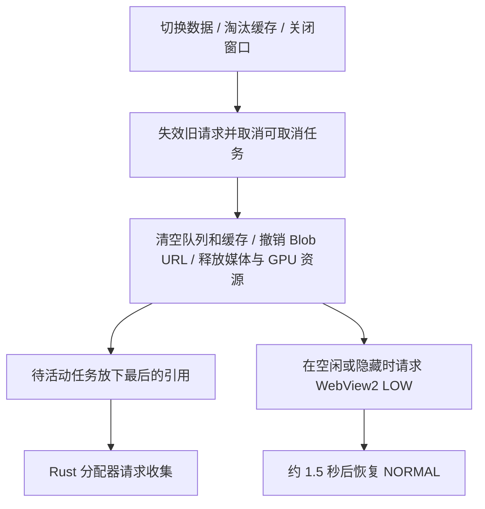

# WebView2 与主程序内存回收实现指南

本文依据 Hiviewer 当前源码编写，说明 Tauri + React + Rust 桌面应用如何限制缓存、释放资源，并请求 WebView2 和原生分配器回收空闲内存。目标是让其他项目可以按相同分层逻辑实现，而不是只复制一个“清理内存”函数。

核对日期：2026-10-15。源码链接均相对于本文所在的 `doc/` 目录；行号会随开发变化，定位时优先搜索函数名。

## 1. 先明确需要解决的三类问题

| 现象 | 原因 | 对应处理 |
|---|---|---|
| 旧图片、任务、监听器长期可达 | 应用仍持有引用，或没有释放外部资源 | 取消任务、解除引用、撤销 URL、解绑监听、关闭句柄 |
| 浏览图片越多，缓存持续增加 | 缓存缺少数量、字节预算或生命周期边界 | LRU 淘汰、限制并发、切换目录和关闭窗口时清理 |
| 引用已经释放，进程占用仍偏高 | 分配器、浏览器解码缓存、GPU 等仍保留资源以便复用 | 在空闲点请求分配器收集和 WebView2 降低内存目标 |

主动回收不能释放仍被使用的数据，也不能代替泄漏修复。工作集暂时没有下降，不足以证明发生泄漏；工作集下降，也不足以证明泄漏已修复。

Windows 下至少涉及两组进程：

- **Rust 宿主进程**：图像解码、统计结果、Rust 缓存等。
- **WebView2 进程组**：浏览器、渲染器、GPU 等。JavaScript 对象、DOM、图片解码及视频资源分布在这些进程中。

此外 FFmpeg 是独立子进程，其生命周期也必须管理。Rust 的分配器收集不会直接清理 WebView2、FFmpeg 或其他库自行管理的分配。

整体处理顺序：



## 2. 技术版本与源码入口

本项目核对到的版本如下；Rust 最终解析版本以 `src-tauri/Cargo.lock` 为准。

| 依赖 | 本项目版本 | 用途 |
|---|---|---|
| React | 19.2.6 | 组件生命周期与清理 |
| `@tauri-apps/api` | 2.12.0 | 前端 IPC、窗口事件 |
| Rust `tauri` | 2.12.3 | 原生窗口和 WebView 访问 |
| `webview2-com` | 0.39.1 | WebView2 COM 接口 |
| Rust `windows`（直接依赖） | 0.62.2 | COM `Interface::cast` |
| `mimalloc` | 0.1.52 | Rust 全局分配器 |
| `libmimalloc-sys` | 0.1.49，启用 `extended` | `mi_collect` FFI |

迁移项目应确认 WebView2 绑定、`windows` 和 Tauri 所用类型版本兼容；不要只独立升级其中一个原生绑定。

| 机制 | 当前项目源码及符号 |
|---|---|
| 全局分配器 | [src-tauri/src/lib.rs](../src-tauri/src/lib.rs)，`GLOBAL` |
| 分配器收集 | [src-tauri/src/mem.rs](../src-tauri/src/mem.rs)，`release_to_os` |
| WebView2 LOW/NORMAL、统一回收命令 | [src-tauri/src/commands/hiviewer.rs](../src-tauri/src/commands/hiviewer.rs)，`set_hiviewer_webview_memory_low`、`hiviewer_trim_memory` |
| 前端 IPC | [src/hiviewer/hiviewerIpc.ts](../src/hiviewer/hiviewerIpc.ts)，`trimMemory` |
| 主窗口空闲触发 | [src/hiviewer/HiviewerLayout.tsx](../src/hiviewer/HiviewerLayout.tsx)，搜索 `2500`、`trimMemory` |
| 比较窗口解码池、关闭清理 | [src/hiviewer/HiviewerCompareWindow.tsx](../src/hiviewer/HiviewerCompareWindow.tsx)，`dropDecodedImagePoolEntry`、`releaseCompareResources` |
| 前端缩略图缓存 | [src/hiviewer/HiviewerThumbnail.tsx](../src/hiviewer/HiviewerThumbnail.tsx)，`rememberThumbnailSrc`、`clearThumbnailClientCache` |
| 原生比较图缓存 | [src-tauri/src/commands/hiviewer.rs](../src-tauri/src/commands/hiviewer.rs)，`compare_decode_cache_prune` |
| 图像统计缓存 | [src-tauri/src/commands/image.rs](../src-tauri/src/commands/image.rs)，`StatsImageCache`、`clear_image_stats_caches` |
| 视频流缓冲与释放 | [src/hiviewer/hiviewerVideoMediaSource.ts](../src/hiviewer/hiviewerVideoMediaSource.ts)，`createFfmpegMediaSession` |
| FFmpeg 进程清理 | [src-tauri/src/commands/video.rs](../src-tauri/src/commands/video.rs)，`stop_video_stream_handles` |

## 3. Rust 主程序：先释放所有权，再请求分配器收集

### 3.1 配置同一套全局分配器和 FFI

以下为迁移用最小配置，在现有 Tauri 项目中合并即可。不要删除项目原有依赖，也不要在同一可执行程序中重复声明全局分配器。

```toml
# src-tauri/Cargo.toml
[dependencies]
mimalloc = "=0.1.52"
libmimalloc-sys = { version = "=0.1.49", features = ["extended"] }
```

```rust
// src-tauri/src/lib.rs
mod mem;

#[global_allocator]
static GLOBAL: mimalloc::MiMalloc = mimalloc::MiMalloc;
```

```rust
// src-tauri/src/mem.rs：核心调用与当前项目一致。
pub fn release_to_os() {
    // 调用分配器的收集入口，请求积极处理可回收内存。
    unsafe {
        libmimalloc_sys::mi_collect(true);
    }
}
```

必须保证分配和收集指向同一套 mimalloc 实例。可以用 `cargo tree --manifest-path src-tauri/Cargo.toml -i libmimalloc-sys` 检查依赖解析；不要将另外动态加载的分配器误当成本程序的 Rust 分配器。

**收集范围边界**：当前 `libmimalloc-sys 0.1.49` 默认构建 mimalloc v3。其 `src/theap.c` 的 `mi_collect` 从 `_mi_theap_default()` 发起收集，源码明确注明不能真正做进程全局收集。因此 `release_to_os` 是项目的封装名称，不代表“清空整个进程内存”的保证。

跨线程释放、仍存活的工作线程堆、碎片和部分占用的页面会影响效果。迁移到长期工作线程架构时，可在工作线程释放大批临时缓冲后的自然空闲点调用收集，并用实测确认；不要从另一线程强行操作线程所属的私有堆，也不要每处理一个小对象就调用收集。

### 3.2 缓存清理与收集按顺序执行

当前项目的比较图清理入口：

```rust
// src-tauri/src/commands/hiviewer.rs
#[tauri::command]
pub fn hiviewer_clear_compare_memory_cache() -> CmdResult<()> {
    clear_compare_decode_cache();
    crate::mem::release_to_os();
    Ok(())
}

fn clear_compare_decode_cache() {
    if let Ok(mut cache) = compare_decode_cache().lock() {
        cache.entries.clear();
        cache.order.clear();
        cache.bytes = 0;
    }
}
```

上面是项目上下文中的源码片段，依赖已有 `CmdResult` 和缓存结构。迁移时需要替换业务符号。

`Arc<DynamicImage>` 从缓存移除后，正在运行的任务若仍持有克隆，图像要等最后一个 `Arc` 释放才销毁。清缓存不会强行中断这些任务；需要同时建立请求取消和结果失效机制。

统计缓存同样先清数据再收集：

- `clear_image_stats_caches()`：RGB、完整统计、直方图、ROI、JPEG bytes 和方向缓存。
- `clear_roi_stats_caches()`：RGB、ROI、JPEG bytes 和方向缓存，保留完整统计与直方图结果。

两者位于 [image.rs](../src-tauri/src/commands/image.rs)。根据当前操作选择清理范围，避免频繁清空马上还要使用的数据。

## 4. WebView2：LOW 脉冲与恢复 NORMAL

### 4.1 最小原生接入代码

下面代码保留本项目核心逻辑，将返回类型简化为 `Result<(), String>`，便于迁移。放在已有 Tauri 项目的 `src-tauri/src/memory_trim.rs` 中。

相关依赖示例：

```toml
# 合并到现有 Cargo.toml；不要重复声明 tauri。
[dependencies]
tauri = { version = "=2.12.3", features = ["unstable"] }

[target.'cfg(windows)'.dependencies]
webview2-com = "=0.39.1"
windows = "=0.62.2"
```

```rust
// src-tauri/src/memory_trim.rs
#[cfg(windows)]
pub(crate) fn set_webview_memory_low(window: &tauri::WebviewWindow, low: bool) {
    use webview2_com::Microsoft::Web::WebView2::Win32::{
        COREWEBVIEW2_MEMORY_USAGE_TARGET_LEVEL_LOW,
        COREWEBVIEW2_MEMORY_USAGE_TARGET_LEVEL_NORMAL,
        ICoreWebView2_19,
    };
    use windows::core::Interface;

    let level = if low {
        COREWEBVIEW2_MEMORY_USAGE_TARGET_LEVEL_LOW
    } else {
        COREWEBVIEW2_MEMORY_USAGE_TARGET_LEVEL_NORMAL
    };
    let _ = window.with_webview(move |platform| unsafe {
        if let Ok(core) = platform.controller().CoreWebView2() {
            if let Ok(core19) = core.cast::<ICoreWebView2_19>() {
                let _ = core19.SetMemoryUsageTargetLevel(level);
            }
        }
    });
}

#[tauri::command]
pub fn trim_memory(webview_window: tauri::WebviewWindow) -> Result<(), String> {
    crate::mem::release_to_os();

    #[cfg(windows)]
    {
        set_webview_memory_low(&webview_window, true);
        let restore = webview_window.clone();
        std::thread::spawn(move || {
            std::thread::sleep(std::time::Duration::from_millis(1500));
            set_webview_memory_low(&restore, false);
        });
    }
    #[cfg(not(windows))]
    let _ = webview_window;

    Ok(())
}
```

在已有 Builder 的命令注册中追加它，避免覆盖现有 command：

```rust
// src-tauri/src/lib.rs，合并到已有代码。
mod memory_trim;

// 在已有 generate_handler![...] 中追加：
// memory_trim::trim_memory
```

项目原始命令叫 `hiviewer_trim_memory`，注册位于 [lib.rs](../src-tauri/src/lib.rs) 的 `generate_handler!`。

### 4.2 调用语义与限制

1. `with_webview` 用于在平台 WebView 的正确线程上下文访问 COM；不要将裸 COM 控制器保存到后台线程调用。
2. `ICoreWebView2_19` 转换失败意味着当前 Runtime 不支持该接口，当前项目选择静默跳过。迁移排查期间可记录失败日志。
3. LOW 是较低内存使用目标，由 Runtime 决定实际释放内容和时机；它不是同步 GC，也不承诺立即降低到某个字节数。
4. 约 1.5 秒后恢复 NORMAL，避免持续处于低内存目标影响后续加载。1.5 秒是本项目策略参数，不是 WebView2 的强制时限。
5. 命令只对发起 IPC 的当前 WebView 设置目标；它不是“遍历并回收所有 WebView2 进程”。进程共享方式由 Runtime 决定。
6. 非 Windows 平台仍执行 Rust 收集，不执行这段 WebView2 COM 调用。
7. 当前实现忽略底层错误，返回 `Ok(())` 仅表示命令执行完毕，不证明回收成功。

**当前实现的并发边界**：每次调用都会创建一个延迟恢复线程，没有合并脉冲。连续调用时，较早的 NORMAL 可能提前结束后一次 LOW。若迁移项目调用频繁，应按原生窗口实例维护 generation 和一个恢复调度器：仅最新 generation 可以恢复 NORMAL，窗口销毁时清理调度状态。不要只按可复用的窗口 label 操作新实例，也不要无上限创建延迟线程。

这项合并属于迁移建议，不是当前项目已经实现的保证。

## 5. 前端：只在合适时机发起回收

### 5.1 typed IPC 与空闲防抖

以下是配套上一节 `trim_memory` 的可迁移示例：

```ts
// src/memory/memoryIpc.ts
import { invoke } from "@tauri-apps/api/core";

export const memoryIpc = {
  trim: () => invoke<void>("trim_memory"),
};
```

```tsx
// src/memory/useIdleMemoryTrim.ts
import { useEffect } from "react";
import { memoryIpc } from "./memoryIpc";

export function useIdleMemoryTrim(idleMs = 2500) {
  useEffect(() => {
    let timer: number | null = null;
    const clear = () => {
      if (timer !== null) window.clearTimeout(timer);
      timer = null;
    };
    const trim = () => {
      clear();
      void memoryIpc.trim().catch((error) => {
        console.debug("Memory trim request failed", error);
      });
    };
    const schedule = () => {
      clear();
      timer = window.setTimeout(trim, idleMs);
    };
    const visibility = () => {
      if (document.visibilityState === "hidden") trim();
    };
    const scrollOptions = { capture: true, passive: true } as const;
    document.addEventListener("scroll", schedule, scrollOptions);
    window.addEventListener("keydown", schedule);
    window.addEventListener("pointerup", schedule);
    document.addEventListener("visibilitychange", visibility);

    return () => {
      clear();
      document.removeEventListener("scroll", schedule, scrollOptions);
      window.removeEventListener("keydown", schedule);
      window.removeEventListener("pointerup", schedule);
      document.removeEventListener("visibilitychange", visibility);
    };
  }, [idleMs]);
}
```

在需要的窗口根组件调用一次 `useIdleMemoryTrim()`。示例组合了空闲与隐藏触发；不要在同一窗口的每个图片组件中调用。

本项目现有触发策略并不完全相同：

| 窗口/事件 | 当前行为 |
|---|---|
| 主窗口 scroll、keydown、pointerup | 最后一次事件后 2500ms 调用；挂载时没有主动启动计时器 |
| 比较窗口 scroll、keydown、pointerup、wheel | 最后一次事件后 5000ms 检查；有预取任务则继续等待，仅解码池超预算才调用 |
| 比较窗口 `visibilitychange` 为 hidden | 立即调用 |
| 比较窗口关闭 | 清理资源、清理原生比较缓存，再尝试调用 trim；原生端另有兜底 |

比较窗口的判断实际为 `decodedImagePoolBytes > imagePreloadPoolMaxBytes()`。它不是根据进程工作集或系统空闲内存判断，也不会在低于预算时无条件每 5 秒回收。

避免在每次滚动、切图、绘制帧时直接 LOW：浏览器刚清掉的解码缓存马上又要重新建立，会造成卡顿与反复解码。

## 6. 前端图片缓存：淘汰必须释放底层资源

### 6.1 缩略图采用双预算

本项目 [HiviewerThumbnail.tsx](../src/hiviewer/HiviewerThumbnail.tsx) 的核心逻辑如下。片段依赖该文件中的缓存和订阅函数：

```ts
const THUMBNAIL_CLIENT_LRU_CAP = 2048;
const THUMBNAIL_CLIENT_PIXEL_BUDGET = 32 * 1024 * 1024;

function revokeCachedThumbnailSrc(src: string | undefined) {
  if (src?.startsWith("blob:")) URL.revokeObjectURL(src);
}

function removeCachedThumbnail(key: string) {
  revokeCachedThumbnailSrc(thumbnailSrcCache.get(key));
  thumbnailSrcCache.delete(key);
  thumbnailPixelBytes -= thumbnailPixelCosts.get(key) ?? 0;
  thumbnailPixelCosts.delete(key);
}

function rememberThumbnailSrc(key: string, src: string, size: number) {
  const previous = thumbnailSrcCache.get(key);
  if (previous && previous !== src) revokeCachedThumbnailSrc(previous);
  if (thumbnailSrcCache.has(key)) thumbnailSrcCache.delete(key);
  thumbnailSrcCache.set(key, src);
  thumbnailPixelBytes -= thumbnailPixelCosts.get(key) ?? 0;
  const pixelCost = Math.max(1, size) ** 2 * 4;
  thumbnailPixelCosts.set(key, pixelCost);
  thumbnailPixelBytes += pixelCost;

  for (const candidate of thumbnailSrcCache.keys()) {
    if (thumbnailSrcCache.size <= THUMBNAIL_CLIENT_LRU_CAP
      && thumbnailPixelBytes <= THUMBNAIL_CLIENT_PIXEL_BUDGET) break;
    if (candidate === key || thumbnailHasCacheListeners(candidate)) continue;
    removeCachedThumbnail(candidate);
  }
  notifyThumbnailCacheListeners(key, src);
}
```

迁移要点：

- 编码后的 JPEG/PNG 大小不能代表解码图片大小；至少按宽 × 高 × 每像素字节数估算。
- 本项目缩略图按目标方形尺寸估算 RGBA8 成本，32 MiB 是预算，不是浏览器真实占用测量值。
- 淘汰跳过当前新条目及仍有订阅者的条目，所以它是软预算。要做到硬约束，还需要限制可见资源数量、尺寸及并发。
- 用 Map 插入顺序实现 LRU 时，读取命中后要删除再插入，使其移到末尾。
- `Map.delete()` 不会撤销 Blob URL，必须明确指定 URL 所有者并负责 `revokeObjectURL()`。

### 6.2 清理后，旧任务不能重新填满缓存

本项目用 generation 判断异步结果是否仍有效，核心处理位于 `pumpThumbnailQueue()`：

```ts
renderThumbnailJob(job)
  .then((src) => {
    if (!thumbnailJobIsCurrent(job)) {
      revokeCachedThumbnailSrc(src);
      job.reject(new Error("thumbnail batch superseded"));
      return;
    }
    if (src) rememberThumbnailSrc(job.key, src, job.size);
    job.resolve(src);
  })
  .catch(job.reject)
  .finally(() => {
    // 当前源码还分别维护后台、远程、idle 计数。
    thumbnailActive -= 1;
    if (thumbnailActiveJobs.get(job.key) === job) {
      thumbnailActiveJobs.delete(job.key);
    }
    scheduleThumbnailQueue();
  });
```

清理流程会推进 `thumbnailCacheGeneration`、拒绝排队任务、撤销已有 URL、清空缓存和队列。清理前已经启动的原生任务未必能够立即停止，但其结果不能再进入新一代缓存，结果携带的新 Blob URL 也必须撤销。

不要在清理时直接将活动任务计数归零：旧任务的 `finally` 还会递减。应由实际运行任务完成后归还计数或 permit。

### 6.3 解码图片池也要断开图片引用

本项目比较窗口只保留当前与相邻页面相关的解码预取，并按字节预算淘汰。释放核心为：

```ts
// HiviewerCompareWindow.tsx，项目上下文片段。
function dropDecodedImagePoolEntry(key: string) {
  const entry = decodedImagePool.get(key);
  if (!entry) return;
  decodedImagePool.delete(key);
  if (entry.bytes > 0) {
    decodedImagePoolBytes = Math.max(0, decodedImagePoolBytes - entry.bytes);
    entry.bytes = 0;
  }
  entry.released = true;
  entry.image.onload = null;
  entry.image.onerror = null;
  entry.image.removeAttribute("src");
  entry.settle();
}
```

`settle()` 让等待该条目的任务可以结束，避免清理后留下永久 pending 的 Promise 和未归还的并发槽。`released` 防止延迟回调重新记账。移除 `src` 与解绑回调只是释放应用引用的步骤，浏览器最终何时归还解码内存仍由 Runtime 决定。

本项目正常解码池默认设置为 1024 MiB，可设范围为 512～4096 MiB，见 [types.ts](../src/hiviewer/types.ts) 的 `DEFAULT_HIVIEWER_COMPARE_DECODED_IMAGE_POOL_MB`。该值只约束这一个池；HDR、高精度像素、GPU 副本和临时缓冲需要额外预算。迁移到低内存机器时应按目标硬件重新选择默认值。

### 6.4 减少额外的浏览器图片缓存

[HiviewerThumbnailSource.ts](../src/hiviewer/HiviewerThumbnailSource.ts) 使用 `fetch(url, { cache: "no-store" })` 后创建 Blob URL。AVIF 缩略图会在 `finally` 中清理源 URL、图片源和临时 Canvas：

```ts
// 项目 renderAvifThumbnailSrc 的清理片段。
finally {
  if (image) image.src = "";
  canvas.width = 0;
  canvas.height = 0;
  if (sourceUrl.startsWith("blob:")) URL.revokeObjectURL(sourceUrl);
}
```

`no-store` 用于减少 HTTP 缓存副本，不代表禁用所有图片解码或 GPU 缓存。返回给调用方的缩略图 Blob URL，由接收它的缓存所有者最终释放。

## 7. Rust 缓存：字节预算、Arc 生命周期与并发一起控制

当前项目主要缓存预算：

| 缓存 | 当前约束 | 释放入口 |
|---|---|---|
| Compare 解码图 | 256 MiB、16 项；单图超过 128 MiB 不缓存 | `hiviewer_clear_compare_memory_cache` |
| RGB 统计图 | 768 MiB、16 张 | `clear_image_stats_caches` / `clear_roi_stats_caches` |
| 完整统计、直方图、ROI 等结果 | 各缓存最多 512 项 | 对应全部清理或 ROI 清理 |
| JPEG 原始字节缓存 | 最多 16 项，未设置独立总字节预算 | 统计清理入口 |

这些额度不能直接当作宿主进程总内存上限。JPEG 项目大小、正在运行的解码和编码任务、源文件数据及 `Arc` 外部引用都可能额外占内存。

比较缓存的核心淘汰循环：

```rust
// src-tauri/src/commands/hiviewer.rs，项目上下文片段。
fn compare_decode_cache_prune(cache: &mut CompareDecodeCache) {
    while cache.entries.len() > COMPARE_DECODE_CACHE_MAX_ENTRIES
        || cache.bytes > COMPARE_DECODE_CACHE_MAX_BYTES
    {
        let Some(oldest) = cache.order.pop_front() else {
            cache.entries.clear();
            cache.bytes = 0;
            return;
        };
        if let Some(entry) = cache.entries.remove(&oldest) {
            cache.bytes = cache.bytes.saturating_sub(entry.bytes);
        }
    }
}
```

实现自己的 Rust 缓存时还要满足：

1. key 包含路径、文件大小、修改时间、解码策略等身份信息，避免文件更新后复用旧图。
2. 插入、覆盖、移除均更新字节计数；访问顺序队列自身也必须有界。当前统计缓存的 `compact_if_needed()` 会移除过期访问记录。
3. 不在持有全局缓存锁时执行耗时 IO 或解码；锁只保护缓存数据和记账。
4. 使用 semaphore 限制活动解码任务，并限制预取队列。单图峰值应计入压缩数据、解码像素、颜色转换和编码输出。
5. 请求 token 检查是协作式失效，不保证强行终止正在执行的第三方解码函数。任务退出、所有引用释放后，内存才具备回收条件。

本项目 Compare 的 `run_compare_image_prepare_job()` 使用 semaphore；预取任务使用 `try_acquire_owned()`，忙时可以跳过，避免预取阻塞前台需求。

## 8. 窗口关闭：前端清理与原生清理双保险

前端核心清理函数：

```tsx
// HiviewerCompareWindow.tsx，项目上下文片段。
const releaseCompareResources = useCallback(() => {
  const cancelToken = (comparePrepareRequestTokenRef.current += 1);
  void hiviewerIpc.cancelCompareImageRequests(cancelToken).catch(() => {});
  void archivePreviewIpc.releaseImages(cancelToken).catch(() => {});
  cancelRoiStatsRequestsRef.current?.();
  for (const entry of managedImagesRef.current.values()) revokeManagedEntry(entry);
  managedImagesRef.current = new Map();
  decodedImagePreloadQueue.length = 0;
  queuedDecodedImagePreloads.clear();
  for (const key of [...decodedImagePool.keys()]) dropDecodedImagePoolEntry(key);
}, []);
```

它同时接入组件卸载和原生标题栏关闭请求。异步监听注册必须处理“注册完成前已经卸载”的情况：

```tsx
// 迁移示例：onClose 中调用同步且可重复的本地资源清理。
useEffect(() => {
  let disposed = false;
  let unlisten: (() => void) | null = null;
  void getCurrentWebviewWindow().onCloseRequested(() => {
    if (!disposed) onClose();
  }).then((stop) => {
    if (disposed) stop();
    else unlisten = stop;
  }).catch((error) => console.debug("Close listener unavailable", error));

  return () => {
    disposed = true;
    unlisten?.();
  };
}, [onClose]);
```

示例需引入 React `useEffect` 和 `@tauri-apps/api/webviewWindow` 的 `getCurrentWebviewWindow`；`onClose` 应为稳定回调。

**不能只依赖页面 unload 中的异步 IPC**。WebView 销毁可能中断尚未完成的消息，因此 Rust 原生窗口事件必须能独立完成后端清理。本项目的兜底为：

```rust
// hiviewer.rs，比较窗口创建过程中的片段。
// compare_window 是当前 window.clone()，不是按 label 重新查找的窗口。
if matches!(
    event,
    WindowEvent::CloseRequested { .. } | WindowEvent::Destroyed
) {
    compare_image_latest_request_token().fetch_add(1, AtomicOrdering::AcqRel);
    clear_compare_decode_cache();
    crate::mem::release_to_os();
    #[cfg(windows)]
    set_hiviewer_webview_memory_low(&compare_window, true);
}
```

关闭清理应能重复调用：清空空 Map、对不存在的资源返回、只释放仍持有的句柄。迁移时如果关闭请求可以被用户取消，需要同步设计“清理后恢复加载”的行为。

主窗口生命周期要单独判断：本项目 Windows 主窗口关闭按钮执行 `prevent_close()` 和 `hide()`，macOS 执行最小化。它们保留页面运行状态，不等同于销毁窗口；隐藏后仍有部分内存是预期行为。

## 9. 视频、GPU 和其他原生资源也需要独立所有者

### 9.1 视频滚动缓冲与背压

[hiviewerVideoMediaSource.ts](../src/hiviewer/hiviewerVideoMediaSource.ts) 采用：

- 每次最多按 64 KiB 追加 SourceBuffer。
- 前向缓冲超过 6 秒时等待，停止继续读取更多流数据。
- 删除播放位置后方的旧范围，保留至少 4 秒，并允许业务要求保留更长 GOP。
- 遇到 `QuotaExceededError` 等待播放或释放，不继续无界读入。

该限制是按媒体时间控制缓冲，实际字节量随码率和关键帧分布变化，不是固定字节硬上限。

核心销毁代码：

```ts
// createFfmpegMediaSession 返回对象中的项目源码片段。
dispose() {
  if (signal.aborted) return;
  abort.abort();
  media.removeEventListener("sourceopen", open);
  void reader?.cancel().catch(() => {});
  if (media.readyState === "open" && buffer) {
    try {
      if (buffer.updating) buffer.abort();
      media.removeSourceBuffer(buffer);
    } catch { /* 可能与 video.load() 解除媒体绑定同时发生。 */ }
  }
  buffer = null;
  URL.revokeObjectURL(url);
}
```

读取循环的 `finally` 还会 `reader.cancel()` 和 `reader.releaseLock()`。外层播放器应执行 `video.pause()`、移除 `src`、`video.load()`，同时通过 IPC 释放后端流。参见 [HiviewerVideoCompareWindow.tsx](../src/hiviewer/HiviewerVideoCompareWindow.tsx) 与 [HiviewerVideoHoverPreview.tsx](../src/hiviewer/HiviewerVideoHoverPreview.tsx)。

### 9.2 FFmpeg 子进程必须 kill 后 wait

关闭网页播放器不等于关闭后端转码器。当前项目的原生释放入口是 `hiviewer_release_video_source`，内部取消排队/活动流，并执行以下操作：

```rust
// video.rs，stop_video_stream_handles 的核心片段。
if let Ok(mut stdout) = handles.stdout.lock() {
    let _ = stdout.take();
}
let status = handles.child.lock().ok()
    .and_then(|mut guard| guard.take())
    .and_then(|mut child| {
        let _ = child.kill();
        child.wait().ok()
    });
if let Some(stderr_thread) = handles.stderr_thread.lock().ok()
    .and_then(|mut guard| guard.take())
{
    let _ = stderr_thread.join();
}
```

这里 `take()` 使句柄的释放归属明确，避免多条清理路径重复操作同一个子进程。停止、等待及 join 可能阻塞，应放在合适的后台执行上下文；本项目单流释放 command 使用 `spawn_blocking`。

转码并发由 [stream_queue.rs](../src-tauri/src/commands/video/stream_queue.rs) 的 semaphore 限制为 8，排队等待可被取消。这个数字是当前业务选择，迁移时需要根据视频分辨率、码率和硬件降低或调整。

### 9.3 GPU、目录树、原生回调

| 资源 | 当前项目处理 |
|---|---|
| WebGPU HDR 纹理和 uniform buffer | `destroy()`；Canvas context 执行 `unconfigure()`，见 [hiviewerHdrCanvas.tsx](../src/hiviewer/hiviewerHdrCanvas.tsx) |
| 临时 ImageBitmap | 使用后 `close()`，同上 |
| 目录树缓存 | 超过 20000 个子节点或 256 项时尝试裁剪，保留展开/加载节点；`dispose()` 清队列、监听与数据，见 [hiviewerDirectoryTreeModel.ts](../src/hiviewer/hiviewerDirectoryTreeModel.ts) |
| Windows HWND 子类过程 | `WM_NCDESTROY` 移除子类并释放原生持有的 `Rc`；回调期间另持有引用抵抗重入，见 [window_dpi.rs](../src-tauri/src/window_dpi.rs) |
| 固实压缩包图片会话 | 设置内存额度、任务 token，闲置 30 分钟释放；见 [useSolidArchivePreview.ts](../src/hiviewer/archive/useSolidArchivePreview.ts)、[archive_solid_memory.rs](../src-tauri/src/archive_solid_memory.rs) |

这些资源不能仅靠 JavaScript GC 或 `mi_collect` 统一解决。每种资源都需要明确的创建者、使用者、释放者和失效条件。

## 10. 迁移实施顺序

1. **先列出资源所有权**：为 Blob URL、图片池、原生缓存、GPU 资源、媒体源、子进程和事件监听分别确定释放者。
2. **实现有界缓存**：数量与字节双预算，限制预取和活动任务，记录当前条目数及估算字节。
3. **建立请求失效协议**：目录、图片组、窗口切换时推进 generation；旧任务返回后先验证身份，再发布结果；过期结果立即释放。
4. **实现可重复的资源清理**：组件卸载、原生关闭事件、任务错误和取消路径都能触发；不能只覆盖正常成功路径。
5. **接入 Rust 分配器收集**：先释放引用再收集，关注工作线程及第三方分配器边界。
6. **接入 WebView2 LOW/NORMAL**：注册 command 和 typed IPC，按窗口实例管理调用；Runtime 不支持时正常降级。
7. **接入空闲触发**：先防抖，再评估业务预算；不要在图片导航、滚动和渲染热路径直接回收。
8. **验证重复操作后的趋势**：确认缓存、监听、句柄、进程数量有界，并比较相同业务状态下的内存。

## 11. 如何验证确实改善，而不是只让任务管理器数字暂时下降

### 11.1 编译与针对性测试

在迁移项目中运行与改动相关的检查。本项目可使用：

```powershell
npm run build
cargo check --manifest-path src-tauri/Cargo.toml
./node_modules/.bin/vitest.cmd run src/hiviewer/HiviewerThumbnail.test.ts src/hiviewer/hiviewerDirectoryTreeModel.test.ts
cargo test --manifest-path src-tauri/Cargo.toml commands::video::stream_queue
```

编译与单测验证类型、淘汰和取消逻辑，不证明真实 WebView2 或 GPU 内存已回收。本文中的迁移示例没有作为新增运行模块接入本项目，需在目标工程中完成编译和实机验证。

### 11.2 运行时观察四类指标

| 层级 | 观察内容 | 判断用途 |
|---|---|---|
| Rust 宿主 | 工作集、Private Bytes、句柄、线程、缓存条目和字节数 | 区分活动数据、分配器保留、句柄/线程增长 |
| WebView2 | 关联进程组内存、JS heap、DOM 节点、解码/GPU 使用情况 | 避免只检查宿主或只检查 JS heap |
| 应用资源 | Blob URL 创建/撤销计数、监听注册/解绑、任务队列 | 定位未配对的资源生命周期 |
| FFmpeg | 子进程数、关闭后退出情况、转码槽位 | 发现浏览器关闭但后台任务仍运行 |

可使用 WebView2 DevTools 的 Memory、Performance，配合 Windows 任务管理器、Process Explorer 或 VMMap。按父子关系识别本应用的进程组，避免把机器上其他应用的 WebView2 内存算进来。

### 11.3 固定输入、重复同一流程

1. 使用同一 Release 构建、同一批媒体文件、同一窗口数量和设置，启动后记录基线。
2. 循环“打开目录 A → 滚动完整列表 → 切到目录 B → 打开比较窗口 → 关闭比较窗口”，建议至少 20 轮。
3. 每轮返回相同业务状态，等待活动任务结束和空闲触发；再等待 LOW 恢复 NORMAL 后记录。
4. 对视频另做“播放 → 暂停 → seek → 换视频 → 关闭窗口”的循环，确认后台 FFmpeg 和流任务结束。
5. 补测加载中关窗、快速切目录、取消排队任务、失败解码、隐藏/恢复窗口和同 label 重建窗口。
6. 观察预热后是否进入稳定区间：缓存不持续超过预期、任务最终清零、监听/句柄/子进程无持续增长；如内存持续增长，继续检查对象引用和原生分配，不能以 trim 后瞬时下降判定通过。

如果关闭操作只是隐藏窗口，应与隐藏窗口的基线比较；不要要求它等于彻底销毁进程后的占用。操作系统和 Runtime 允许保留可复用资源，也不承诺每轮回到完全相同的 RSS 数值。

## 12. 当前实现的边界与参考资料

本项目已经具备缓存淘汰、资源释放、任务失效、分配器收集请求和 WebView2 LOW 脉冲。它没有实现进程级硬内存上限、完整的实时泄漏检测、所有窗口共享的回收调度器，或“回收完成且减少多少字节”的确认协议。

迁移时尤其不要做以下替换：

- 用定时 `trim_memory` 代替撤销 Blob URL、取消任务、释放句柄。
- 仅限制 Map 项数，就认为大图片、JPEG bytes、临时编码缓冲已按字节受限。
- 仅执行清缓存，就假设外部 `Arc`、正在运行的解码及浏览器副本已经释放。
- 用强制压缩工作集掩盖仍在增长的活动分配；工作集降低并不等于解除引用。

官方 API 依据：

- [ICoreWebView2_19：MemoryUsageTargetLevel](https://learn.microsoft.com/en-us/microsoft-edge/webview2/reference/win32/icorewebview2_19)
- [WebView2 进程模型](https://learn.microsoft.com/en-us/microsoft-edge/webview2/concepts/process-model)
- [mimalloc 官方 API](https://microsoft.github.io/mimalloc/group__malloc.html)
- [libmimalloc-sys 0.1.49](https://docs.rs/libmimalloc-sys/0.1.49/libmimalloc_sys/)
- [URL.revokeObjectURL](https://developer.mozilla.org/en-US/docs/Web/API/URL/revokeObjectURL_static)
- [MediaSource.removeSourceBuffer](https://developer.mozilla.org/en-US/docs/Web/API/MediaSource/removeSourceBuffer)

本文交付范围为源码机制说明和迁移指南，没有新增内存回收运行代码，也没有进行长期运行内存采样。
